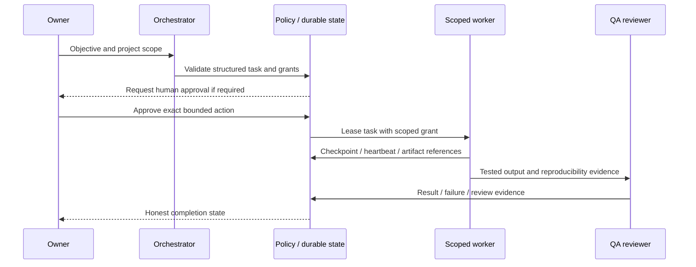

# Agent system inventory and proposed contracts

> Phase 0 discovery snapshot · 2026-10-31 · baseline `d6774c0c131d460cae08b55ccde7eedc984843d1`
> Recommendations are not implementations or authorization. No application, dependency, schema, infrastructure or production changes were made.

## Current evidence

`src/lib/agent-runtime` implements lifecycle/scheduling/execution paths. `multi-agent-orchestrator/types.ts` has company/user IDs, task and step statuses, dependencies, limits, retries and approval references. Registry/workforce catalogs and tests already exist. Source templates and rows do not prove agents are operational. Multiple orchestration and queue implementations require call-graph mapping before extension.

## Required role reconciliation

Preserve current definitions; map the following logical roles to existing IDs/skills/permissions before adding any missing entries:

1. Chief Orchestrator; 2. Research; 3. Repository Audit; 4. Architecture;
5. Reverse Engineering; 6. Browser Inspection; 7. API Analysis; 8. Android Analysis;
9. Binary Analysis; 10. Database Analysis; 11. UI/UX Analysis; 12. Coding;
13. Frontend; 14. Backend; 15. Database Engineer; 16. Security;
17. QA/Testing; 18. DevOps; 19. Documentation; 20. Code Review.

No role/identity was created or provisioned during this audit. Pilot recommendation: orchestrator, repository audit, coding, QA and security/review; later split specialization based on measured bottlenecks.

## Structured task contract proposal

Required fields: schemaVersion, taskId, projectId/companyId, requesting user, agentId, objective, input artifact references/digests, required permissions, expected output schema/artifacts, dependency IDs, deadline/max runtime, token/cost/resource budgets, status, retry policy (maximum attempts/backoff/retryable errors), approval scope/reference and audit correlation ID. No unrestricted shared conversation or secrets in contract payloads.

States: draft→validated→waiting_approval/queued→leased→running→succeeded/failed/cancelled; recoverable failures schedule bounded retries, exhausted work enters dead letter. Dependency cycles must reject at validation; cancellation propagates deliberately. Persist transition versions and checkpoint references before returning success. Heartbeat leases cannot guarantee exactly-once external side effects; enforce idempotency at tool boundaries.

All interactions above are target behavior; no live multi-agent pipeline verified here. Existing queue recovery tests should be rerun in disposable MySQL and SQLite environments before claiming restart survival.
