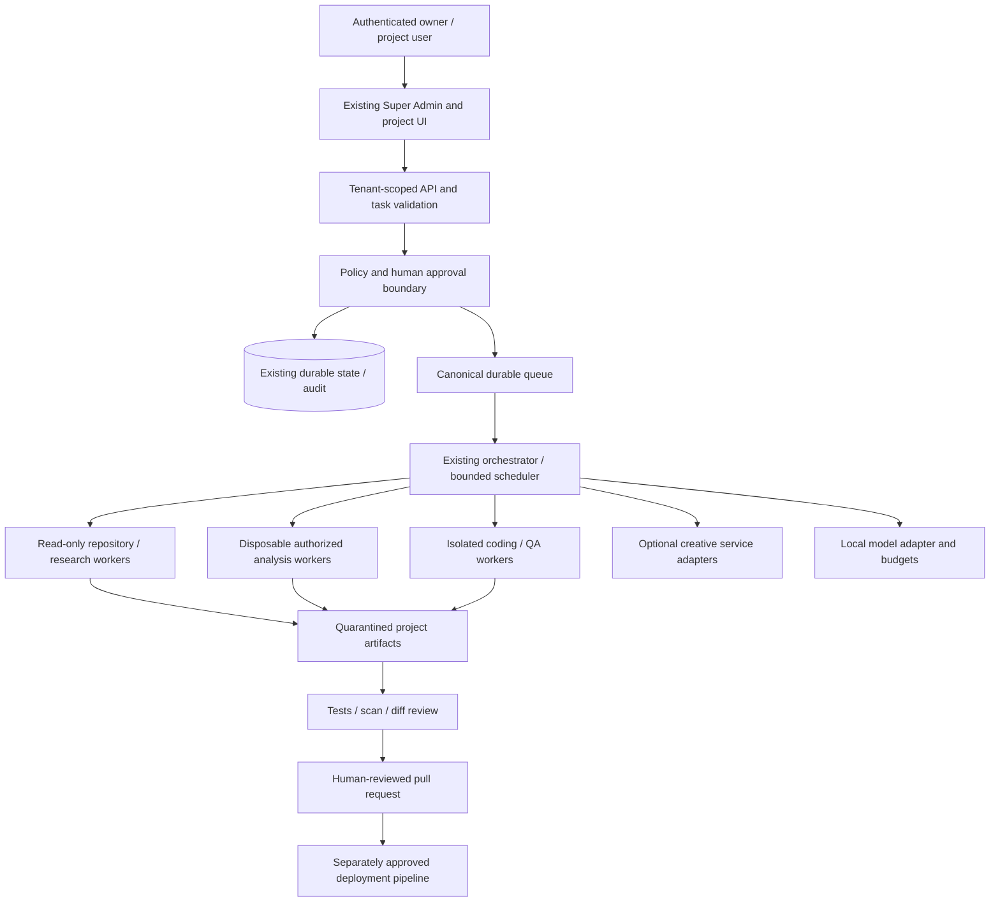

# Master architecture — discovery recommendation

> Phase 0 discovery snapshot · 2026-10-31 · baseline `d6774c0c131d460cae08b55ccde7eedc984843d1`
> Recommendations are not implementations or authorization. No application, dependency, schema, infrastructure or production changes were made.

## Existing system and recommended direction

Retain Next.js/React/TypeScript, existing authentication/admin panels, Prisma database policy, provider adapters and durable queue. Do not introduce a second orchestration framework. Keep production MySQL/MariaDB pending verified environment inventory; do not force Postgres merely because an optional service uses it. Existing `pg` helpers are not authority to change the primary database.

Diagram is proposed target flow, not deployed topology. No new services provisioned.

## Eight layers, additive evolution

1. **Core:** choose the existing DB-leased queue as candidate durable authority; inventory and bridge other queues without deleting their consumers. Durable task states, history, retries, dependencies and approval transitions must be one transactionally consistent path.
2. **Orchestrator:** typed project-scoped tasks, bounded DAG scheduling, per-agent grants and resource admission. Pilot five roles first; reconcile all 20 required roles with existing registry IDs before creating rows.
3. **Laboratory:** service adapters around disposable browser/API/Android/binary workers; signed authorization scope and immutable sample hash before execution.
4. **Factory:** repository read→proposal→human gate→approved branch workspace→implement→tests→security review→PR. Merge/deploy outside agent grants by default.
5. **QA:** existing test runner plus approved browser/API/accessibility tooling in separate test projects. Artifact/report reproducibility independent of build success.
6. **Memory:** keep existing DB stores; add mandatory project ownership, provenance and verification at service contracts before considering schema changes.
7. **Creative:** independent capability-negotiated adapters, disabled unless configured and licensed. No creative runtime dependency in core scheduling.
8. **Governance:** reuse panels with source-linked evidence/status, approval review, audit events, measured usage and null/unknown values for unavailable metrics.

## Integration contract proposal

Every adapter should expose descriptor (name/version/digest/license/capabilities), health probe, input/output schema, required permissions, network destinations, max CPU/RAM/time/artifact size, cancellation, idempotency and structured errors. Submission references tenant/project/task/actor/approval; response references artifacts by hash and provenance, never inline secrets. Distinguish configured, reachable, tested and approved states. Prefer process/HTTP/MCP boundaries with schema validation and authenticated local transports; MCP itself is not an authorization boundary.

## Preliminary data design, not a migration

Map existing Agent/Task/QueueItem/Approval/AuditEvent/Memory models to requirements. Proposed logical extensions: scoped action digest and expiring single-use grant; durable workflow checkpoint; artifact digest/provenance; project-owned verified fact; capability evidence record. Inventory actual schema/data and all consumers before proposing exact fields/indexes. No database dialect interchangeability assumed; no SQL is authorized here.

## Dashboard semantics

- Implemented + verified: code and linked passing evidence for stated environment/version.
- Partial: working subset, with missing guarantees listed.
- Experimental: isolated proof only, disabled in production.
- Planned: design only, no runtime implementation.
- Blocked: explicit dependency/configuration/access/license issue.
- Requires human approval: precise scoped operation awaiting authorized reviewer.

Status and health are separate dimensions; counts show configured/provisioned/running/successfully tested separately. No demo counters or green fallback health. Dashboard changes are recommendations for later approval, not completed in Phase 0.

## Design gate

Phase 1 must finalize contract schemas, threat boundaries, database mapping, diagrams, SLOs and resource/cost budgets, and obtain owner approval before Phase 2. This discovery architecture does not satisfy implementation acceptance criteria.
