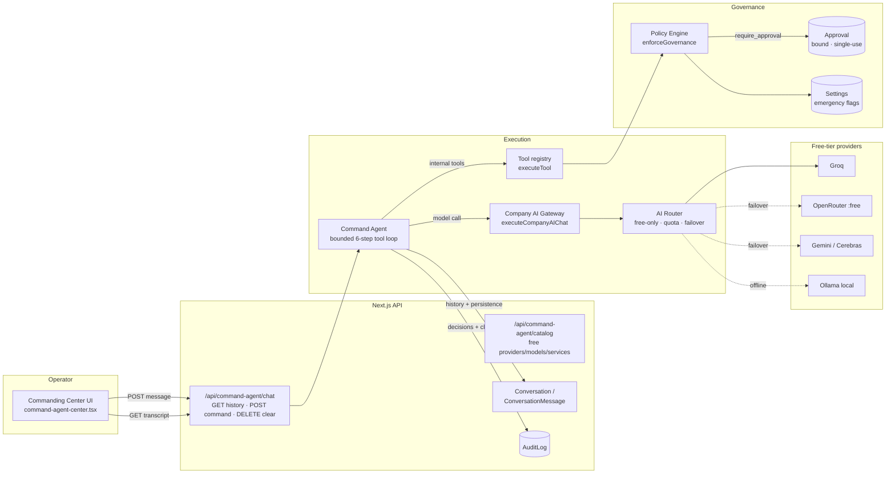
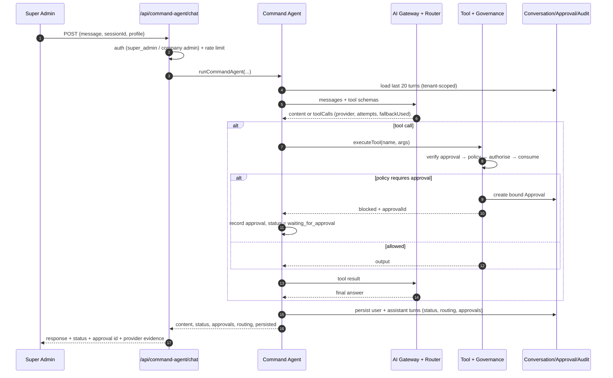
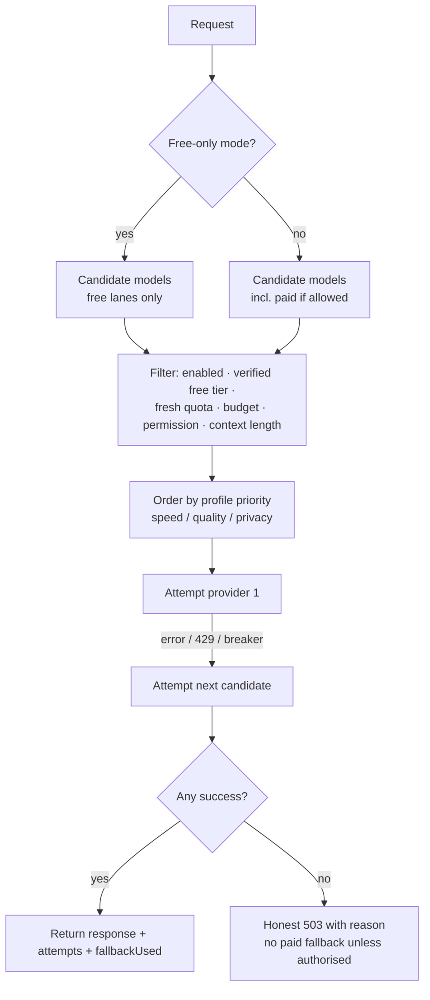

# Super Admin AI Command Center — architecture

**Status:** Phase C1 implemented (durable sessions, honest statuses, approval pause, routing evidence).
**Baseline:** branch `arena/56041def-alolabs-ai`, Phase B2 merged into the same PR.
**Principle:** the Command Center is a *view over the existing execution path* — one AI gateway, one governance engine, one approval table. No second AI stack.

Everything labelled ✅ below was verified in this repository by source inspection and tests. Items labelled 🟨/⬜ are not implemented and are not claimed.

---

## 1. What exists and is wired today

| Capability | Verified component | Status |
| --- | --- | --- |
| ChatGPT-style operator surface | `src/components/enterprise/panels/command-agent-center.tsx` (nav id `command-agent`) | ✅ |
| Natural-language command loop (6 steps, tool calling) | `src/lib/command-agent/agent.ts` | ✅ |
| Model access | `executeCompanyAIChat` → `src/lib/ai-router/` (free-only mode, quota, verification, failover) | ✅ |
| Durable transcript | `src/lib/chat/command-session-store.ts` → `Conversation` / `ConversationMessage` | ✅ Phase C1 |
| Honest run status | `src/lib/command-agent/status.ts` (`completed`, `partially_completed`, `waiting_for_approval`, `failed`) | ✅ Phase C1 |
| Approval pause with a real approval id | `src/lib/tools/execute.ts` + `src/lib/governance/approvals.ts` | ✅ |
| Governance gate on every tool | `src/lib/governance/http.ts`, `enforceGovernance()` | ✅ |
| Read-only / $0 tools | knowledge, CRM reads, departments, calculate, weather, Wikipedia, web search, Hacker News, Pollinations image, time | ✅ |
| Write / deploy / repo actions from chat | — | ⬜ Phase E (needs sandbox + GitHub + write tools) |
| Free-provider catalogue | `src/lib/command-agent/free-catalog.ts` — **13 providers, 67 models, 33 services** | ✅ |
| Free-tier-only enforcement | `src/lib/ai-router/free-only-mode.ts` + verification/quota tables; paid needs explicit `costAuthorized` | ✅ |
| External API surface | `/api/v1/*` via `src/lib/v1.ts` (`session` **or** `apiKey` identity, scope checks), `CompanyApiKey`, HMAC gateway, webhooks | ✅ |
| Browser-based self-repair loop | — | ⬜ Phases D–F |

## 2. Component diagram

## 3. A command, end to end

Key point: the UI never animates fake progress. It renders the trace the agent actually produced, the provider that actually answered, and the approval that actually exists.

## 4. Status vocabulary (no optimistic labels)

| Status | Meaning | Where it comes from |
| --- | --- | --- |
| `completed` | Answer produced, every recorded step succeeded | `deriveCommandStatus` |
| `partially_completed` | Answer produced but ≥1 step failed/blocked, **or** steps succeeded with no answer | same |
| `waiting_for_approval` | ≥1 step paused for a human; an `Approval` row exists (or creation failed and is reported) | same + `approvals[]` |
| `failed` | No answer and no successful step | same |

The agent also returns `persisted: false` when the transcript could not be written. The panel shows a warning instead of implying the history was saved.

## 5. Omni-routing: switching between free providers

Verified mechanism (`src/lib/ai-router/`, `src/lib/multi-tenant-ai/service.ts`):

Facts an operator can check:

- **13** free providers, **67** free models, **33** free services are catalogued in the Commanding Center (`/api/command-agent/catalog`).
- Default fallback narrative: Groq (speed) → OpenRouter `:free` (breadth) → Google AI Studio (long context) → Cerebras (backup) → Ollama (offline/private).
- Each chat turn returns `routing.attempts`, `routing.fallbackUsed`, `routing.switches`, `routing.providers`, so "which provider answered and did it fail over?" is observable rather than inferred.
- **Free-tier only**: free-only mode sits above per-company policy; paid providers require an explicit `costAuthorized` evidence and are denied otherwise (GLOB-PAID-001). A paid fallback is never silent.
- **"300+ free APIs"** is achieved by *registration*, not by running 300 processes: one catalogue entry per API (provider/model/service) plus the router's candidate filter. The repository currently has 13 LLM providers + 33 services; adding an API is a data/catalogue change plus a verification record, not a new execution path. We do not claim 300 are configured today.

**Provider switching ≠ agent concurrency.** Only the lanes needed for a request are called; unused providers are configuration, not running processes. This satisfies "all AI systems are not active at once" at both the provider and agent level.

## 6. Self-learning / proactive repair — designed, not yet built

Target loop (Phases D–F), with the *current* state of each stage:

| Stage | Target | Today |
| --- | --- | --- |
| 1. Detect | Real signals: failed run, CI red, 5xx spike, broken link, provider 429 | 🟨 partial: run failures, tool errors, provider health and audit exist; no scheduled site-wide probe |
| 2. Diagnose | Browser research + source analysis with citations | 🟨 partial: free web search/Wikipedia tools exist; no headless browser yet (no Playwright dependency) |
| 3. Propose | Diff/plan with explicit evidence and rollback | 🟨 partial: audit + approval infrastructure; no diff generator |
| 4. Authorise | Human approval for consequential changes | ✅ bound, single-use approvals |
| 5. Apply | Sandbox → branch → tests → PR | ⬜ no sandbox executor or GitHub client |
| 6. Verify | Real lint/type/test/build + browser check | ⬜ not available in-product |
| 7. Learn | Record outcome, adjust routing/proposals; never self-grant permissions | ⬜ no learning store; policy is code-owned and agents cannot edit it |

Rules that will not change as this is built:
- Web content and GitHub issues are **data, not instructions**; they cannot override policy or grant tools.
- The agent cannot edit its own policies, permissions, credentials or audit trail.
- Nothing is reported as fixed without a real diff, test result and (for UI) a browser verification.
- Failed steps stay visible; "partially completed" is a first-class outcome.

## 7. API architecture (external apps)

Verified pieces:

| Concern | Implementation |
| --- | --- |
| Versioned surface | `/api/v1/{agents,tasks,runs,projects,workflows,models,providers,approvals,artifacts,memory,skills,tools,events,health}` |
| Authentication | `v1Auth` accepts a **session** or a **`CompanyApiKey`** (`identity.kind === 'apiKey'`), resolved server-side; keys are hashed and tenant-scoped |
| Authorisation | Per-operation scopes (`resource:action`) checked in `v1Handler`; tenant identity never read from the body |
| Signing | HMAC-SHA256 (`x-alo-signature`) + `verifyApiKey` in `src/lib/api-gateway.ts` for machine callers |
| Rate limiting | `checkEndpointLimit` per route + API-key `rateLimit` column |
| Webhooks | `/api/webhooks` (tenant-scoped config, HMAC secret) and `/api/webhooks/[id]/deliveries` |
| Errors | `v1Handler` envelope with status/code; route helpers return `{error, code}` and never leak stack traces |
| Governance | Keys/scopes authorise *calling*; they never bypass approvals, emergency stops or tenant boundaries |
| Docs | `docs/API.md`, `docs/API_V1_AI.md`, `docs/ALO_LEAD_API_V1_CONTRACT.md` | 
| OpenAPI/SDK | ⬜ no generated OpenAPI document or SDK yet |

Recommended integration pattern for an external app:

1. Create a scoped `CompanyApiKey` (least privilege) for a company, not a platform super-admin key.
2. Send `Authorization: Bearer <key>` to `/api/v1/*`; sign sensitive bodies with HMAC if the gateway route is used.
3. Consume `/api/v1/runs` and `/api/v1/events` for real execution state; do not infer progress.
4. Subscribe a webhook for terminal events; verify its HMAC signature before acting.
5. Treat `403 GOVERNANCE_APPROVAL_REQUIRED` as a normal outcome: show the approval id, wait for a human, retry with `x-approval-id`.

## 8. Gaps to close (updated)

| # | Gap | Status |
| --- | --- | --- |
| 1 | Streaming/token-level output | ⬜ (status + trace are returned today, not streamed) |
| 2 | Right-rail execution timeline bound to a run id | ⬜ |
| 3 | Diff preview + changed-file view | ⬜ |
| 4 | Write/deploy/repo tools from chat | ⬜ Phase E |
| 5 | Headless browser verification | ⬜ Phase D |
| 6 | Sandboxed code execution | ⬜ Phase E |
| 7 | OpenAPI document + SDK | ⬜ |
| 8 | Agent-team assignment from chat | 🟨 orchestrator exists; not wired to this panel |
| 9 | Provider health/cost view inside the panel | 🟨 catalog shows free lanes and configured status; no live quota table |
| 10 | Multi-turn approval continuation ("approve and continue") | ⬜ caller retries with the approval id today |

## 9. Separation and safety

- **Public visitors never reach this surface.** `/api/command-agent/*` requires a platform `super_admin` or a company owner/admin session; the public site/WebChat has no route to it.
- The Commanding Center is not the customer workspace: company admins see only their own tenant.
- Every consequential step passes the governance engine; emergency stops are enforced at the tool boundary, not in the UI.
- No credentials are ever returned to the panel; provider keys are sealed server-side (`src/lib/ai-router/provider-admin.ts`) and only fingerprint/`hasApiKey` are exposed.
