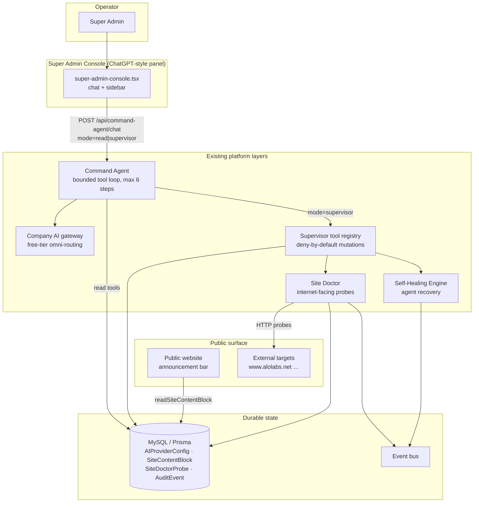
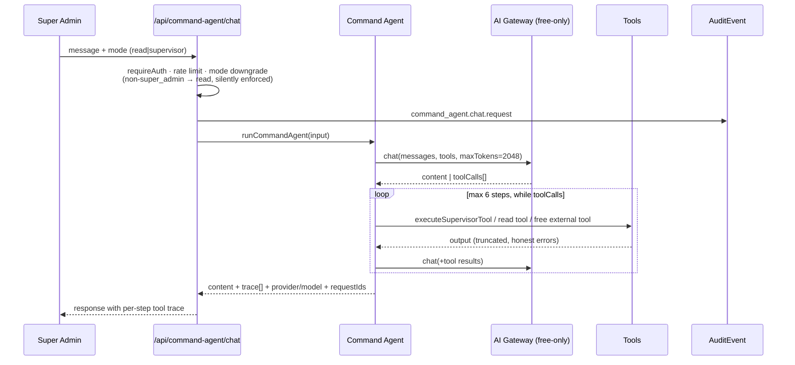
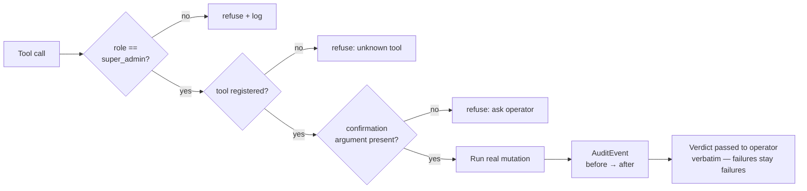
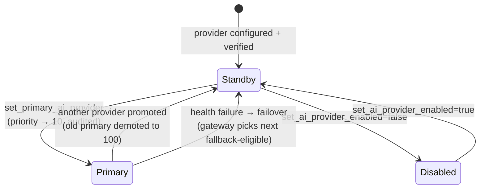
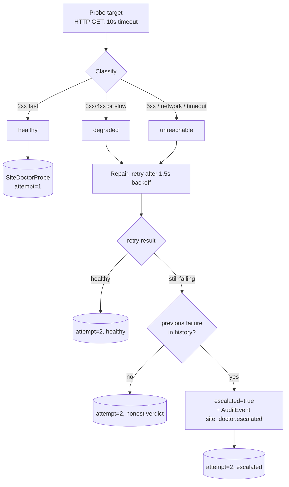
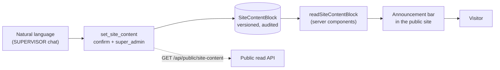

# Super Admin Console — Architecture

> Generated: 2026-11-25 · Branch `feat/super-admin-console` off `main @ 51d20f9`. Companion to `docs/architecture/CENTRAL_PLATFORM_AUDIT.md`. Principle carried over from the Master Directive: **every action is real, traceable, and honest — no simulated success.**

## 1. System context

The console is the natural-language control hub on top of the existing platform layers. It introduces no parallel stack: every capability it exposes already exists behind a guarded route.

## 2. Natural-language command execution (tool-calling protocol)

The agent follows a bounded **tool-calling loop** (OpenAI-style function calling, enforced at 6 steps), routed through the free-tier gateway so every model call inherits policy, budgets, verification and usage metering. Model order (omni-routing): Groq → OpenRouter `:free` → Gemini/Cerebras → Ollama, as configured in the Super Admin AI Control Plane.

**Supervisor mutation gate** (all five conditions, in order):

## 3. Omni-routing — one active primary, standby ring

Providers are never all "active at once" in the routing sense: the policy always promotes **exactly one primary** (lowest `priority` wins) and keeps the rest as standby. The supervisor tool `set_primary_ai_provider` re-orders priority; `set_ai_provider_enabled` removes/returns a provider entirely. Every switch is audited with before → after.

Failover stays automatic inside a turn (timeout → next fallback-eligible candidate), which is what makes the 300+ free-API routing platforms usable: the catalogue (`free-catalog.ts`) lists providers with verification pointers, the Control Plane holds verified configs, and the policy composes the live chain per request.

## 4. Self-healing — two loops, one ledger

**Loop A — internal agents** (existing `SelfHealingEngine`): health monitor → unhealthy agent → strategy (retry/restart/rollback/escalate) → max 3 attempts → event bus. The supervisor tool `run_self_healing_recovery` triggers it on demand and reports the engine's verdict **verbatim**.

**Loop B — internet-facing (Site Doctor, new)**: probes what the outside world sees.

No repair is ever reported as done when it did not happen: a retry that still fails is recorded as still failing (and escalated only when it is a repeat failure). Targets come from `SITE_DOCTOR_TARGETS` (comma-separated) with a sensible single-target default; an empty configuration produces an honest "no targets" report, not a green pass.

## 5. Website updates via natural language

End-to-end real path (no code-file editing at runtime):

`readSiteContentBlock` always falls back to the shipped code default on missing/malformed data — a console edit can never break a page. Writes are versioned and audited; the console sidebar shows the live blocks.

## 6. Protocols & conventions followed

- **Tool-calling protocol**: OpenAI-style function-call JSON schemas for every agent tool (read + supervisor registries); bounded loop; tool output truncation.
- **Capability-based security**: mutations are a separate, explicitly-registered capability gated on role, confirmation and audit — deny by default, mirroring the v1 gateway scope model (`v1-auth.ts`).
- **Event-driven integration**: recoveries, escalations and console actions emit on the existing event bus / AuditEvent ledger rather than direct side channels.
- **Additive-only persistence**: new tables (`SiteContentBlock`, `SiteDoctorProbe`) via migration `20261125_super_admin_console.sql` with a dedicated rollback file; no destructive ALTER.
- **Free-first**: the console runs on the same free-only gateway policy (`AI_API_MODE=disabled`, verified free providers); no paid API can be reached without the `approved_paid` authorization workflow (unchanged).

## 7. Component map (all paths verified on this branch)

| Piece | Path |
|---|---|
| Console panel (UI) | `src/components/enterprise/panels/super-admin-console.tsx` |
| Navigation registration | `src/lib/dashboard/navigation.ts` (Command section + import map) |
| Supervisor tool registry | `src/lib/command-agent/supervisor-tools.ts` |
| Agent loop extension | `src/lib/command-agent/agent.ts` (`mode`) |
| Chat route (mode gating) | `src/app/api/command-agent/chat/route.ts` |
| Site Doctor | `src/lib/self-healing/site-doctor.ts` |
| Healing engine (actor param) | `src/lib/self-healing/index.ts` |
| Site content read helper | `src/lib/site-content.ts` |
| Public announcement bar | `src/components/site/announcement-bar.tsx` (+ `src/app/layout.tsx`) |
| API: doctor status/run | `src/app/api/super-admin/site-doctor/route.ts` |
| API: public content read | `src/app/api/public/site-content/route.ts` |
| Migration + rollback | `prisma/migrations/mysql/20261125_super_admin_console*.sql` |
| Tests | `__tests__/unit/supervisor-tools.test.ts`, `__tests__/unit/site-doctor.test.ts` (+ regression `command-agent.test.ts`) |

## 8. Honest limitations

1. The site doctor detects and retries/escalates — it does not (yet) automatically rebuild or redeploy the website; that step runs through the Git/CI workflow and is a documented next step.
2. Model-side command understanding still needs at least one configured free provider (Groq/OpenRouter/Gemini/Cerebras/Ollama). Without one, the gateway returns the honest "Configuration required" error — the console reports it verbatim instead of faking an answer.
3. Supervisor mutations are non-transactional reads-then-writes; concurrent console edits could interleave (version numbers are informational, audit entries always capture the actual before/after).
4. The standalone typecheck/build gate could not run in the 4 GB sandbox (OOM, exit 137) — verification evidence for this PR: lint 0, full vitest suite, and the target-file runs above.
